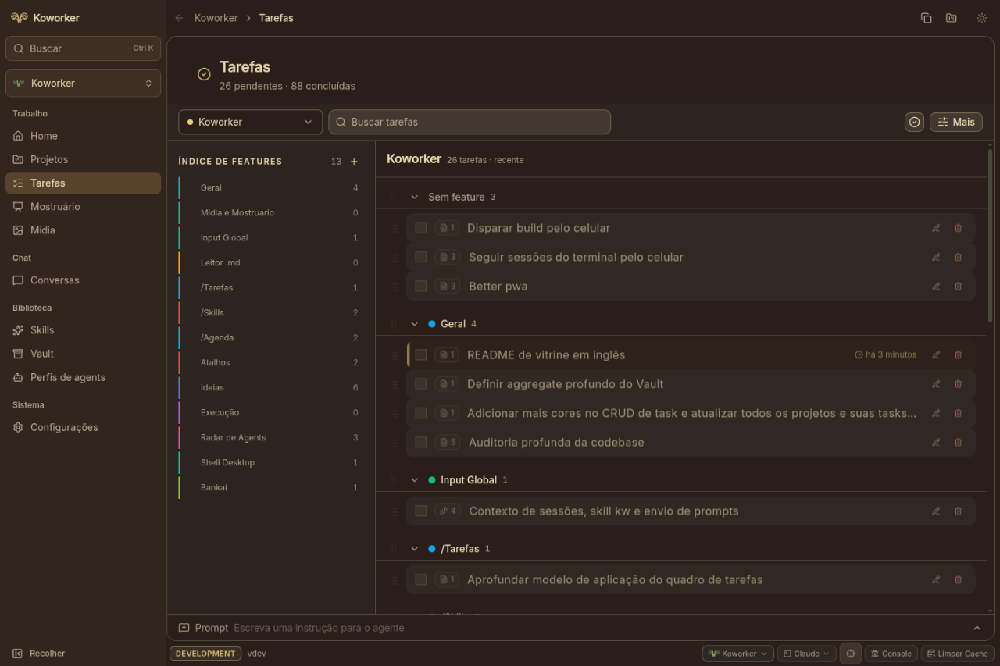
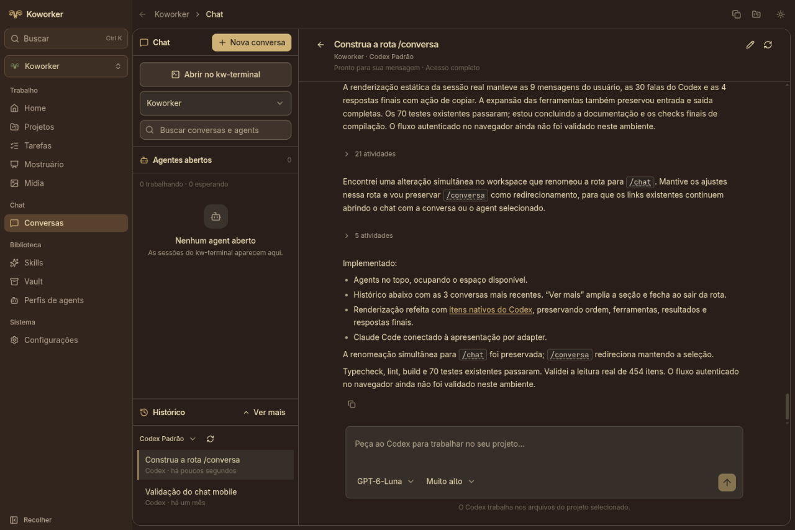
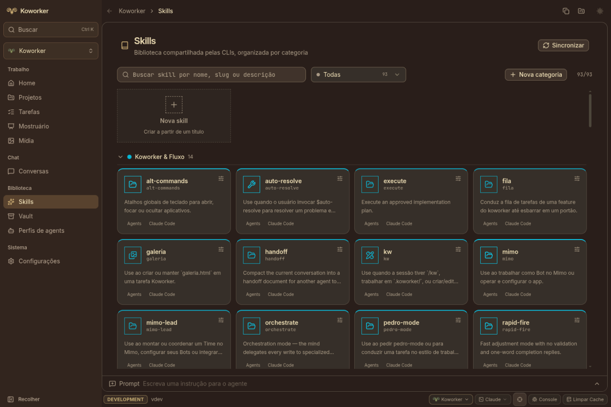

<div align="center">


# Koworker

**A local workspace for projects, tasks, and AI coding agents.**<br>
Keep your code, context, and conversations in one place.


[Run locally](#run-locally) · [Under the hood](#under-the-hood) · [Documentation](#documentation)

<br>



<sub>Built with Koworker, managed in Koworker. Screenshots show the current Portuguese interface.</sub>

</div>

## Highlights

- **One workspace per project.** Open coding CLIs, run project commands, and find context files from a single launchpad.
- **Tasks backed by Markdown.** Plans, notes, and deliverables live in your project folder, readable by you and your agents.
- **Conversations with context.** Chat with Codex, import CLI history, and follow terminal agents with their tools and results.
- **A shared skill library.** Browse, edit, and organize reusable instructions across coding CLIs.
- **Local data.** SQLite stores the app state. Project files stay on disk; coding agents use their configured providers.

## Follow the work

Read agent output as a conversation. Inspect tool activity, choose a model and reasoning effort, and respond to questions or approvals.

<p align="center">
  
  <br>
  <sub>A conversation from Koworker's own development, continued inside the app.</sub>
</p>

## Keep instructions close

Skills turn your workflow into reusable instructions. Group them by category and edit their files without leaving the workspace.

<p align="center">
  
</p>

## Run locally

Requires [Bun](https://bun.sh). Agent features also need the corresponding coding CLI installed and authenticated.

```bash
git clone https://github.com/pedrinhopagan/koworker.git
cd koworker
cp .env.example .env
```

In `.env`, set `DATABASE_URL` to a local SQLite path, such as `db.sqlite`. Set a unique `JWT_SECRET`, `KOWORK_ADMIN_USER`, and `KOWORK_ADMIN_PASSWORD`.

```bash
bun run setup
bun dev
```

Setup installs dependencies, prepares SQLite, creates the configured admin account, and builds the frontend, backend, and Electron shell.

For the browser interface, use `bun run dev:web` and open [localhost:2841](http://localhost:2841). The same credentials apply.

## Under the hood

| Layer | Built with |
| --- | --- |
| Interface | React 19, TanStack Router & Query, Zustand |
| Styling | Tailwind CSS 4, Radix UI |
| API & live updates | Bun, ORPC, WebSockets |
| Storage | SQLite, Kysely, Markdown files |
| Desktop | Electron with a local Bun backend |
| Agent CLI | `kw-cli`, with direct database access and storage locks |

<details>
<summary>Development commands</summary>

| Command | Purpose |
| --- | --- |
| `bun dev` | Start the desktop app in development mode |
| `bun run dev:web` | Start the browser interface and backend |
| `bun run typecheck` | Check TypeScript |
| `bun run oxlint` | Run the linter |
| `bun test` | Run the existing test suite |
| `bun run desktop:pack` | Build an unpacked desktop app |
| `bun run desktop:build` | Build desktop packages for the host platform |
| `bun run cli` | Show the agent CLI commands |

</details>

## Documentation

[Desktop architecture](docs/desktop/README.md) · [Terminal integration](docs/TERMINAL.md) · [Agent sessions](docs/SESSOES.md) · [Skills](docs/skills.md)
