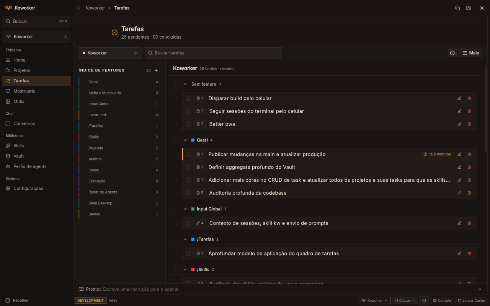
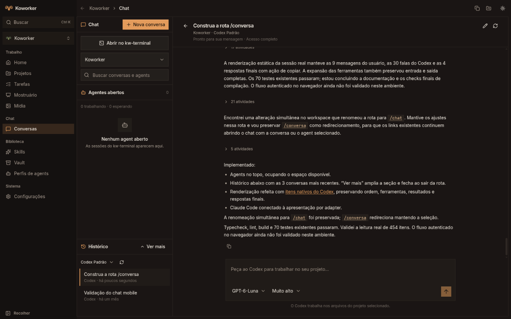
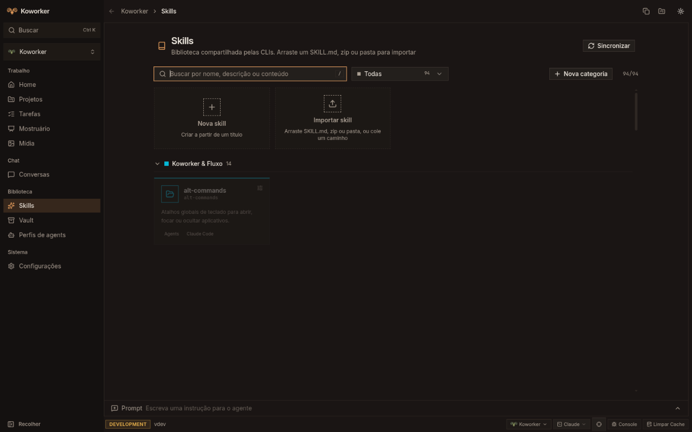
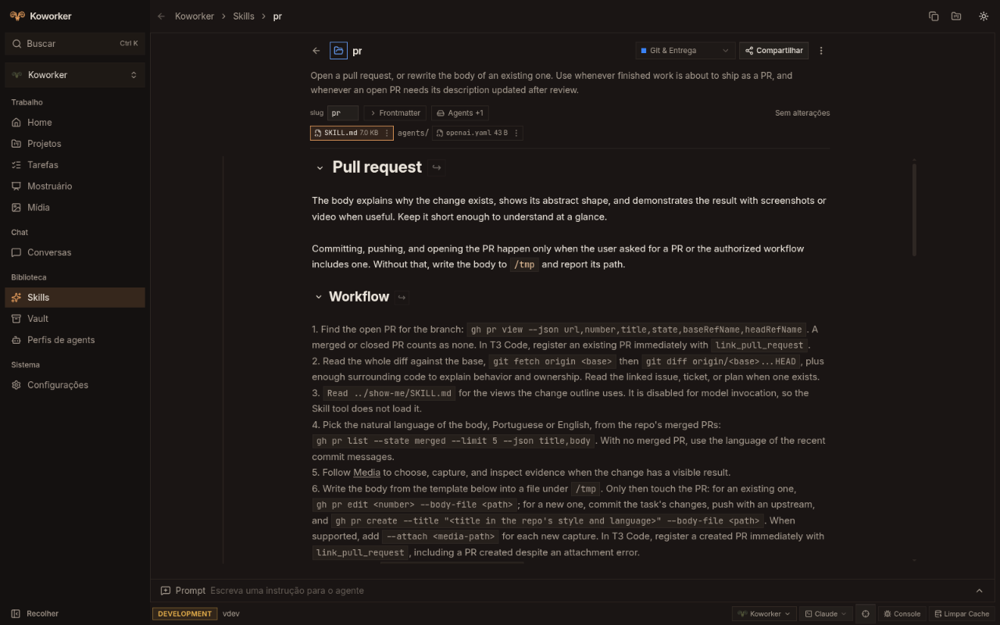
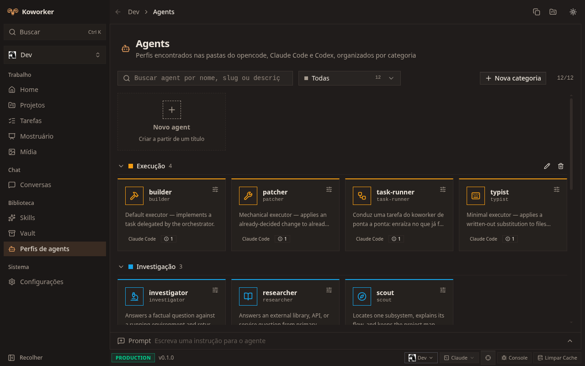
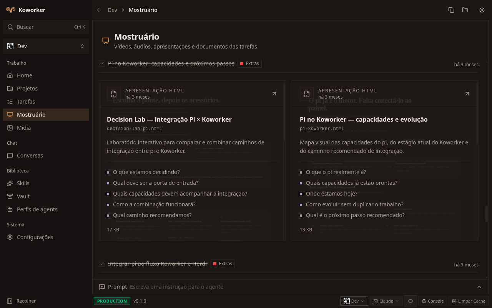

<div align="center">


# Koworker

**Task control for building features with AI coding agents.**<br>
Give every task its own context, so each agent session starts from what matters.


[How it works](#how-it-works) · [Run locally](#run-locally) · [Connect your agent](#connect-your-agent) · [Under the hood](#under-the-hood) · [Documentation](#documentation)

<br>



<sub>Built with Koworker, managed in Koworker. Screenshots show the development workspace in Portuguese.</sub>

</div>

## Why Koworker

Coding agents work best with focused context. A long chat history mixes old decisions, abandoned ideas, and unrelated work. Koworker splits a feature into tasks and gives each task a folder of Markdown files: the plan, the decisions, and the results. A new session reads that task and continues from there.

- **Features and tasks.** Group tasks by feature, order them, and mark them done. Agents create tasks; you organize them.
- **Context on disk.** Each task lives in `.koworker/tasks/<feature>/<task>/`, with an `index.md` linking its deliverables. You and your agents read and edit the same files.
- **Built for agents.** The bundled `kw` skill and `kw-cli` let any coding CLI create tasks, write files, and close work without leaving the terminal.
- **Worktree delivery.** Tasks can carry their branch, merge target, and pull request until they are merged.
- **Local data.** SQLite stores the index. Task content stays in your project folder; agents use their own configured providers.

## How it works

1. Register a project with its repository path.
2. Ask your agent to plan a feature with the `kw` skill. It creates the tasks through `kw-cli` and writes the plan into each task folder.
3. Work one task per session. The agent loads only that task's files, records decisions and results, and links them in `index.md`.
4. Review, edit, reorder, and complete the tasks in the app. To resume later, point a new session at the same task.

## Manage the rest of your agent tooling

Koworker also keeps the tools around agent development in one place.

- **Conversations.** Chat with Codex, follow agents running in the terminal with their tool calls and results, and reopen past Claude and Codex sessions.
- **Skills.** Search, edit, categorize, import, and share the skill library your CLIs load.
- **Agents.** Browse and edit agent definitions, with labels, icons, and categories.
- **Showcase.** Browse the presentations, documents, and media agents generated inside tasks, grouped by task, and open them in one click.
- **Project launchpad.** Open coding CLIs, run project commands, and reach context files from each project's page.
- **Vault and media.** Edit loose notes and browse images saved with your tasks.

<p align="center">
  
  <br>
  <sub>A conversation from Koworker's own development, continued inside the app.</sub>
</p>

<p align="center">
  
</p>

<p align="center">
  
</p>

<p align="center">
  
</p>

<p align="center">
  
</p>

## Run locally

Requires [Bun](https://bun.sh). Agent features also need the corresponding coding CLI installed and authenticated.

```bash
git clone https://github.com/pedrinhopagan/koworker.git
cd koworker
cp .env.example .env
```

In `.env`, set `DATABASE_URL` to an absolute SQLite path on your computer. Set a long, random `JWT_SECRET` and choose `KOWORK_ADMIN_USER` and `KOWORK_ADMIN_PASSWORD`.

```bash
bun run setup
bun dev
```

Setup installs dependencies, prepares SQLite, creates the configured admin account, and builds the frontend, backend, and Electron shell.

For the browser interface, use `bun run dev:web` and open [localhost:2841](http://localhost:2841). The same credentials apply.

## Connect your agent

Register your project in the app with its repository path. Then, from the Koworker clone, register the CLI:

```bash
bun link
kw-cli version
```

Keep Bun's global binaries on your agent's `PATH`. Set `KOWORK_DATABASE_URL` to the same absolute path as the app's `DATABASE_URL`.

Install the bundled [kw skill](static/skills/kw/SKILL.md) in your agent's skill directory. For the shared directory:

```bash
mkdir -p ~/.agents/skills
cp -R static/skills/kw ~/.agents/skills/
```

Compare any existing `kw` skill before replacing it. Add this rule to your agent's global instructions, adjusting the path:

```text
For work in a project registered in Koworker, load and follow
~/.agents/skills/kw/SKILL.md.
```

Start a new agent session in the registered project and ask:

```text
Use the kw skill to plan report exports for this project.
```

The agent creates tasks through `kw-cli` and saves plans, decisions, and results under the project's `.koworker/` folder. The app lets you read, edit, organize, and complete them.

Each task has an `index.md` linking its deliverables. To resume later, ask your agent to read the task's existing files before continuing.

Task content stays outside Git. Back up both `.koworker/` and the SQLite database.

## Under the hood

| Layer | Built with |
| --- | --- |
| Interface | React 19, TanStack Router & Query, Zustand |
| Styling | Tailwind CSS 4, Radix UI |
| API & live updates | Bun, ORPC, WebSockets |
| Storage | SQLite, Kysely, Markdown files |
| Desktop | Electron with a local Bun backend |
| Agent CLI | `kw-cli`, with direct database access and storage locks |

<details>
<summary>Development commands</summary>

| Command | Purpose |
| --- | --- |
| `bun dev` | Start the desktop app in development mode |
| `bun run dev:web` | Start the browser interface and backend |
| `bun run typecheck` | Check TypeScript |
| `bun run oxlint` | Run the linter |
| `bun test` | Run the existing test suite |
| `bun run desktop:pack` | Build an unpacked desktop app |
| `bun run desktop:build` | Build desktop packages for the host platform |
| `bun run cli` | Show the agent CLI commands |

</details>

## Documentation

[Desktop architecture](docs/desktop/README.md) · [Terminal integration](docs/TERMINAL.md) · [Agent sessions](docs/SESSOES.md) · [Skills](docs/skills.md)
