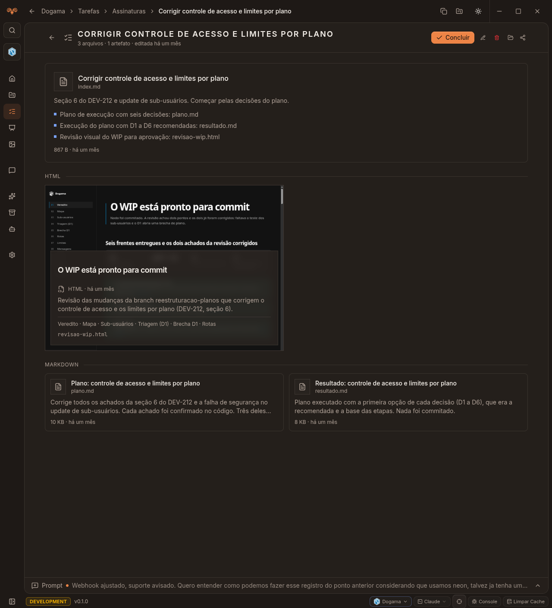

# Koworker

Organize o trabalho com agentes de programação em projetos, tarefas e arquivos que você pode reabrir. O Koworker reúne planos, decisões, resultados e artefatos em uma interface clara, para você ver, editar e continuar o trabalho das iterações anteriores.



Uma tarefa reúne o contexto escrito pelo agente e os artefatos produzidos durante o trabalho.

## Como usar

1. **Cadastre seu projeto.** Na área Projetos, informe o nome e a pasta raiz do repositório no seu computador. É nessa pasta que o contexto será guardado.
2. **Trabalhe com seu agente usando a skill `kw`.** A cada interação, o agente identifica a tarefa correspondente ao pedido ou cria uma quando o assunto ainda não tem tarefa. Planos, descobertas, decisões e resultados úteis ficam vinculados a ela.
3. **Acompanhe pelo app.** Abra a tarefa para ler e editar os arquivos Markdown, consultar o índice do trabalho e visualizar artefatos, como a revisão em HTML da imagem acima. As tarefas podem ser agrupadas por feature.
4. **Retome de onde parou.** Em uma nova sessão, peça ao agente para continuar a tarefa e informe seu caminho, ou deixe que ele a encontre pela CLI. Ele lê o contexto salvo antes de avançar, e as próximas entregas ficam na mesma pasta.

Depois de instalar a skill, um pedido pode ser tão simples quanto:

```text
Use a skill kw para planejar a exportação de relatórios deste projeto.
```

Em outra sessão:

```text
Use a skill kw para continuar a tarefa de exportação de relatórios.
Leia o plano e os resultados anteriores antes de implementar a próxima etapa.
```

### O contexto fica no seu projeto

Cada tarefa tem uma pasta dentro de **`.koworker/`, na raiz do projeto em que você está trabalhando**. Os arquivos Markdown guardam o contexto durável; o banco local do app mantém o cadastro e a organização das tarefas.

Nos projetos com layout v2, a estrutura é:

```text
meu-projeto/
├── src/
├── .gitignore
└── .koworker/
    └── tasks/
        └── relatorios--<feature-key>/
            └── exportar-relatorios--<task-key>/
                ├── index.md
                ├── plano.md
                ├── resultado.md
                └── revisao.html
```

`index.md` funciona como mapa do trabalho. Cada entrega durável ganha um arquivo, e o índice aponta para ele. Assim, você consegue consultar o que foi decidido, ajustar um plano e continuar a tarefa em outra sessão com o contexto das iterações anteriores.

Ao criar uma tarefa, o Koworker adiciona `.koworker/` ao `.gitignore` do projeto. Esse conteúdo fica local e fora dos commits; mantenha backup dos arquivos e do banco. Projetos com layout anterior continuam legíveis, e a CLI informa o caminho real de cada tarefa.

### A skill `kw` conecta o agente ao app

A [skill `kw`](static/skills/kw/SKILL.md) está incluída neste repositório, em `static/skills/kw/`. Ela orienta o agente a buscar uma tarefa existente antes de criar outra, ler seu contexto e registrar as novas entregas pela CLI `kw-cli`.

As tarefas são criadas pelos agentes. Pela interface, você acompanha, edita, organiza e conclui o trabalho. Para esse fluxo acontecer em toda interação, o agente precisa carregar a skill e ter acesso à CLI.

Você pode adicionar esta regra ao **`AGENTS.md` global** do seu agente, ajustando o caminho para onde instalou a skill:

```markdown
Em toda interação de trabalho em um projeto cadastrado no Koworker, carregue e
siga a skill kw em ~/.agents/skills/kw/SKILL.md.
```

Use o arquivo global de instruções reconhecido pelo seu agente; algumas ferramentas usam outro nome, como `CLAUDE.md`. A regra global mantém a orientação entre sessões, e você também pode invocar `kw` explicitamente no pedido.

## Instalação

Você precisa de [Bun](https://bun.sh), Git e do agente de programação que pretende usar, já instalado e autenticado. O desktop usa Electron; o banco é SQLite local e dispensa um servidor de banco de dados.

### 1. Clone e configure

```bash
git clone https://github.com/pedrinhopagan/koworker.git
cd koworker
cp .env.example .env
```

Edite o `.env` antes de rodar o setup:

- `DATABASE_URL`: caminho absoluto do banco. O exemplo contém um caminho da máquina do autor; substitua pelo caminho do seu computador.
- `JWT_SECRET`: uma chave secreta longa e aleatória.
- `KOWORK_ADMIN_USER` e `KOWORK_ADMIN_PASSWORD`: seu usuário e senha para entrar no app.

Para usar o mesmo banco padrão do desktop e da CLI, execute este comando. Ele cria o diretório de dados da sua plataforma e imprime a linha que deve substituir `DATABASE_URL` no `.env`:

```bash
bun -e '
import { mkdirSync } from "node:fs";
import { koworkerDataDir, koworkerDatabasePath } from "./src/lib/app-paths";
mkdirSync(koworkerDataDir(), { recursive: true });
console.log(`DATABASE_URL=${JSON.stringify(koworkerDatabasePath())}`);
'
```

### 2. Prepare e abra o app

```bash
bun run setup
bun run dev
```

O setup instala as dependências, prepara o banco, cria o usuário configurado e compila frontend, backend e shell Electron. `bun run dev` abre o app desktop. Entre com as credenciais do `.env` e cadastre seu primeiro projeto.

Para usar apenas a versão web local:

```bash
bun run dev:web
```

Abra `http://localhost:2841`.

### 3. Disponibilize a CLI e a skill para o agente

Na pasta clonada do Koworker, registre o comando global:

```bash
bun link
kw-cli version
```

O diretório de binários globais do Bun precisa estar no `PATH` do terminal usado pelo agente. A CLI usa o banco padrão da plataforma; para um banco personalizado, defina `KOWORK_DATABASE_URL` com o mesmo caminho absoluto usado em `DATABASE_URL` pelo app.

Copie a pasta `static/skills/kw/` para o diretório de skills do seu agente. Para usar a pasta compartilhada `~/.agents/skills/`:

```bash
mkdir -p ~/.agents/skills
cp -R static/skills/kw ~/.agents/skills/
```

Se você já tem uma skill `kw`, confira as diferenças antes de substituir seus ajustes. Nas ferramentas que usam outro diretório de skills, instale a mesma pasta no local reconhecido por elas. Adicione a regra ao arquivo global de instruções conforme descrito acima e inicie uma nova sessão para carregar a skill.

Você também pode consultar e organizar as skills na área Skills do app.

### 4. Confira a integração no seu projeto

Execute na **raiz do projeto que você cadastrou**, com o mesmo caminho informado no app:

```bash
cd /caminho/do/seu-projeto
kw-cli project list
kw-cli feature list
kw-cli task list --all
```

A partir daí, peça ao agente para trabalhar usando `kw`. Ele usa uma feature existente ou cria uma, registra a tarefa e grava os arquivos pela CLI. `kw-cli` sem argumentos mostra os comandos disponíveis.

### Gerar um pacote desktop

```bash
bun run desktop:pack
bun run desktop:build
```

`desktop:pack` gera uma pasta executável. `desktop:build` gera os instaladores da plataforma atual em `electron/release/`: AppImage e DEB no Linux, RPM quando `rpmbuild` está disponível, NSIS no Windows e DMG no macOS. Mais detalhes em [Desktop Electron + Bun](docs/desktop/README.md).

## Desenvolvimento

O app usa Bun, ORPC, Kysely e SQLite no backend; React 19, TanStack Router/Query, Zustand, Tailwind e Radix no frontend; Electron no desktop.

```bash
bun run typecheck
bun run oxlint
bun run test
bun run check
```

`bun run check` reúne typecheck, lint e testes. A [base de conhecimento para agentes](AGENTS.md) descreve a estrutura do código e suas convenções; [TERMINAL.md](docs/TERMINAL.md) documenta a integração com o terminal.
